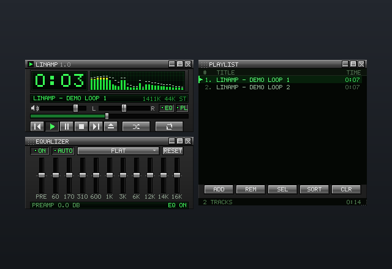
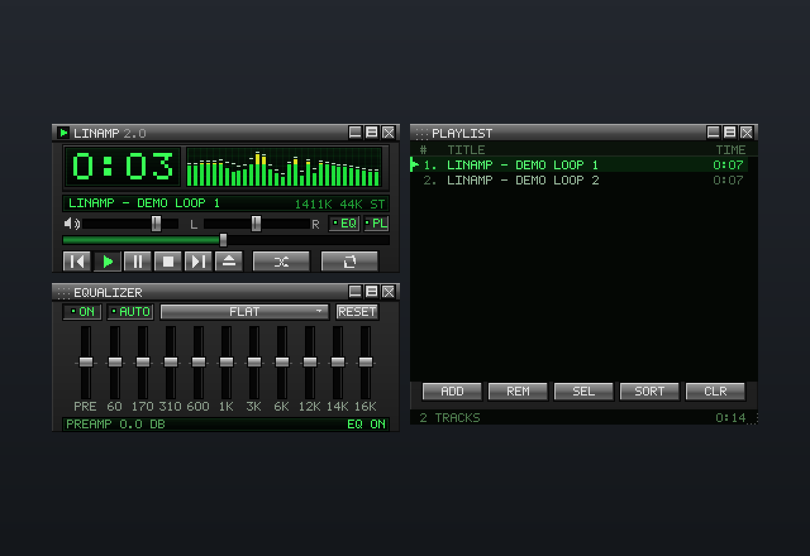

# LINAMP

**Linamp** (Linux + Winamp) adalah pemutar musik desktop native bergaya **Winamp 2.x**,
ditulis dengan **C++ / SDL3 + FFmpeg** — tanpa Qt, tanpa Electron, tanpa Node.
Seluruh UI digambar sendiri ke satu buffer piksel 5×7 font bitmap.



*Screenshot memakai background gradient agar panel terlihat — di desktop, area kosong
sepenuhnya transparan (hanya panel Winamp yang tampil).*

Ukuran UI mengikuti skala HiDPI: canvas dirender langsung di resolusi fisik
(mis. monitor 1920×1080 @ scale 1.25 → buffer 800×550), jadi teks tidak ikut
di-upscale dan tetap tajam. Untuk skin yang 100% piksel-sempurna, pakai skala
integer di compositor (`monitor=...,1` atau `...,2`); di skala pecahan beberapa
garis jadi 1–2 px karena sifat fractional scaling. Bisa dipaksa manual dengan
`LINAMP_PIXEL_SCALE=1.25`.

Kalau ukuran 640×440 terasa kecil, tekan **Ctrl+D** (atau menu → *Double size*):
seluruh skin di-render 2× dengan nearest-neighbour, persis fitur *Double Size* Winamp 2.x.



## Fitur

**Player**
- Play / pause / stop / next / previous / eject, shuffle, repeat.
- Seek bar, volume, balance, mute, elapsed/remaining.
- Bitrate, sample rate, dan indikator stereo asli dari stream.
- Format mengikuti FFmpeg: MP3, FLAC, OGG/Opus, M4A/AAC, WAV, WMA, AIFF.
- Drag & drop file ke jendela, atau tombol **ADD** / eject.
- File dialog native lewat XDG desktop portal (fallback `zenity`).

**Audio engine native**
- Decode FFmpeg → resample 48 kHz stereo float (`libswresample`) → ring buffer → SDL audio stream.
- Equalizer **10 band asli** (biquad peaking 60 Hz–16 kHz) + preamp, diproses per-sample.
- AUTO gain untuk mengompensasi boost EQ, plus clip guard.
- FFT 2048-point → spectrum analyzer 31 band + oscilloscope, sinkron dengan audio.
- **Semua state terakhir** disimpan di `~/.config/linamp/state.json`: playlist, track aktif,
  posisi & ukuran panel, tinggi playlist, panel terbuka/shaded, panel terdepan, mode
  visualizer, elapsed/remaining, shuffle/repeat, EQ, volume, balance.

**UI ala Winamp**
- Tiga panel: main window, equalizer, playlist — bisa digeser, di-snap, dan di-shade.
- Jendela **frameless + transparan**: yang terlihat hanya panel Winamp, langsung di atas desktop.
- Titlebar metalik, LCD hijau dengan scanline, tombol bevel, tooltip kuning.
- Bitmap font 5×7 buatan sendiri untuk skin (LCD, marquee, playlist, tombol).
- Semua digambar di resolusi fisik (HiDPI-aware, skala pecahan pun tetap tajam).
- Menu, help, dan tooltip memakai font UI sistem (TrueType) supaya enak dibaca —
  sama seperti versi Qt-nya. Kalau tidak ada font sistem, otomatis jatuh ke bitmap font.
- **Double size** (`Ctrl+D`): seluruh skin di-render 2×, seperti Winamp 2.x.
- Playlist dengan seleksi (Ctrl/Shift), scroll, sorting, shuffle, resize tinggi panel, context menu.
- Menu klasik Win95 (klik logo LINAMP), help overlay (F1), drag & drop overlay.
- Drag area kosong (transparan) untuk memindahkan jendela aplikasi.

## Kenapa tanpa Qt

Versi Qt dari Linamp memakai **Qt Quick + Qt Multimedia + FFmpeg sistem**, sehingga
AppImage-nya 103 MB. Yang sebenarnya dibutuhkan aplikasi ini cuma:

| Butuh | Qt | Sekarang |
| --- | --- | --- |
| Menggambar kotak/teks/histogram | QML scene graph | canvas ARGB + blit ke texture |
| Teks skin (LCD, marquee, playlist, tombol) | QML `Canvas` + bitmap font 5×7 | bitmap font 5×7 digambar sebagai rect |
| Teks menu / help / tooltip | QML `Text` + font sistem | font sistem via stb_truetype (fallback ke bitmap font) |
| Window frameless + alpha + drag | `startSystemMove()` | `SDL_SetWindowHitTest` (`xdg_toplevel.move` di Wayland, `WM_NCHITTEST` di Windows, `setMovableByWindowBackground` di macOS) |
| Drag & drop / dialog file | QtQuick.Dialogs | `SDL_EVENT_DROP_FILE`, `SDL_ShowOpenFileDialog` |
| Audio output | `QAudioSink` | `SDL_OpenAudioDeviceStream` (PipeWire/Pulse/ALSA/WASAPI/CoreAudio) |
| Decode | FFmpeg sistem (semua codec video) | FFmpeg static, **hanya decoder audio** |

Hasilnya: **AppImage ±3,5 MB** (dari 103 MB), dengan DSP, EQ, dan tampilan yang sama.

## Build & jalankan

Kebutuhan (Arch/Omarchy):

```bash
sudo pacman -S --needed sdl3 ffmpeg pkgconf gcc make
```

PipeWire atau PulseAudio harus aktif untuk output audio.

```bash
# build (Makefile, pakai SDL3 + FFmpeg sistem)
./build.sh

# jalankan
./run.sh

# pasang launcher aplikasi + icon
./install-desktop.sh
```

Setelah install, cari **Linamp** di launcher Omarchy.

### Build release (CMake, static)

Build rilis memakai **SDL3 static** + **FFmpeg static slim** supaya hasilnya satu
file kecil tanpa dependensi library tambahan:

```bash
./packaging/build-sdl3.sh "$PWD/deps/sdl3"        # SDL3 static
./packaging/build-ffmpeg.sh "$PWD/deps/ffmpeg"    # FFmpeg static, audio only

cmake -S . -B build-cmake -DCMAKE_BUILD_TYPE=Release \
      -DCMAKE_PREFIX_PATH="$PWD/deps/sdl3" \
      -DFFMPEG_ROOT="$PWD/deps/ffmpeg"
cmake --build build-cmake --parallel "$(nproc)"
./build-cmake/linamp
```

Tanpa `FFMPEG_ROOT`, CMake memakai FFmpeg dev package dari distro (bisa jalan, tapi
paketnya jadi besar karena semua codec video ikut ter-link).

- **Windows**: build dengan MSYS2/MinGW64 (`mingw-w64-x86_64-SDL3` + FFmpeg static), atau MSVC.
- **macOS**: SDL3 static dari `packaging/build-sdl3.sh`, FFmpeg static, lalu `codesign`.
- **Linux/AppImage**: lihat `.github/workflows/release.yml` (AppDir minimal + `appimagetool`).

## Rilis multi-platform

Workflow GitHub Actions ada di `.github/workflows/release.yml` dan dipicu oleh
tag `v*` (bisa juga dijalankan manual dari tab **Actions**):

```bash
git tag v1.1.0
git push origin v1.1.0
```

| Platform | Artifact | Ukuran |
| --- | --- | --- |
| Linux x86_64 (glibc 2.39+) | `linamp-linux-x86_64.AppImage` | ±3,5 MB |
| Windows x64 | `linamp-windows-x64.zip` | ±2 MB (`linamp.exe` + `SDL3.dll`) |
| macOS arm64 | `linamp-macos-arm64.dmg` | ±4 MB |

`SHA256SUMS.txt` ikut diunggah.

Catatan rilis:

- Build Windows/macOS belum code-signed/notarized. SmartScreen/Gatekeeper bisa
  menampilkan peringatan; di macOS klik kanan → **Open**.
- Build macOS saat ini **arm64** (Apple Silicon). Intel butuh build terpisah.
- “Selalu floating” di Linux adalah window rule compositor; di Windows/macOS jendela
  berjalan sebagai window biasa.

## Selalu floating

Window rule Hyprland untuk Linamp (app id = `linamp`):

```lua
-- Linamp music player: floating, transparan, tanpa border/shadow/rounding.
o.window({ class = "^[lL]inamp$" }, {
    float = true,
    size = { 640, 440 },
    border_size = 0,
    rounding = 0,
    no_shadow = true,
    no_blur = true,
    tag = "-default-opacity",
    opacity = "1.0 override 1.0 override"
})
```

Rule ini membuat Linamp selalu terbuka sebagai floating window transparan berukuran
640×440 — tanpa border, shadow, rounding, atau blur dari compositor.
Hapus blok tersebut jika ingin ikut tiling seperti jendela lain.
Kalau class-nya berbeda di sistem lain, cek dengan `hyprctl clients`.

## Shortcut

| Tombol | Fungsi |
| --- | --- |
| `Space` | Play / pause |
| `X` / `C` | Play / pause |
| `V` | Stop |
| `Z` / `B` | Previous / next |
| `←` / `→` | Seek ±5 detik (`Shift` = ±30 detik) |
| `↑` / `↓` | Volume — atau navigasi playlist kalau fokus di playlist |
| `Shift` + `↑` / `↓` | Perluas seleksi playlist |
| `PgUp` / `PgDn` | Playlist per halaman |
| `Home` / `End` | Awal / akhir playlist |
| `Enter` | Play track yang terpilih di playlist |
| `M` | Mute |
| `S` / `R` | Shuffle / repeat |
| `T` | Elapsed / remaining |
| `Y` | Bars / oscilloscope |
| `E` / `L` | Equalizer / playlist |
| `Ctrl+D` | Double size (skin 2×) |
| `Del` | Hapus track terpilih |
| `F1` | Help |
| `F11` | Fullscreen |
| `Ctrl+Q` | Quit |

**Fokus playlist**: panel playlist dianggap fokus kalau pointer ada di atasnya, atau
panel playlist adalah panel terakhir yang diklik/di-raise. Selama fokus di playlist,
`↑`/`↓` memindahkan seleksi (bukan volume) dan daftar ikut scroll supaya baris aktif
selalu kelihatan; pindahkan pointer ke panel player untuk kembali mengatur volume.

## Struktur

```
  Makefile                       build lokal (SDL3 + FFmpeg sistem)
  CMakeLists.txt                 build rilis / CI (SDL3 + FFmpeg static)
  build.sh                       wrapper Makefile
  run.sh                         build-if-needed + jalankan
  install-desktop.sh             pasang icon + .desktop (Linux)
  packaging/
    build-sdl3.sh                build SDL3 static
    build-ffmpeg.sh              build FFmpeg static, hanya decoder audio
    linamp.desktop               desktop entry untuk AppImage/install
    linamp.rc.in                 resource icon Windows
  .github/workflows/release.yml  CI Linux/Windows/macOS + release
  src/
    main.cpp                     SDL init, main loop, dev helpers
    app.h/.cpp                   state, controller, panel & overlay rendering
    engine.h/.cpp                FFmpeg decode, ring buffer, EQ, FFT, SDL audio
    prober.h/.cpp                probe durasi file di background
    ui.h/.cpp                    widget immediate-mode (button, slider, menu, tooltip)
    gfx.h/.cpp                   canvas ARGB: rect, gradient, garis, clip, alpha, mask teks
    font.h/.cpp                  bitmap font 5×7 (port dari PixelFont.js)
    text.h/.cpp                  font UI sistem (stb_truetype) untuk menu/help/tooltip
    third_party/stb_truetype.h   single-header TTF rasterizer (public domain)
    json.h/.cpp                  parser/dumper JSON mini untuk state
    util.h/.cpp                  URL↔path, scan folder, path config/cache
  assets/icon.png                icon aplikasi
```

## Cara kerja singkat

1. **AudioEngine** membuka file lewat libavformat, decode dengan libavcodec,
   lalu resample ke float stereo 48 kHz. Decoder berjalan di thread sendiri dan
   mengisi ring buffer 3 detik.
2. Callback audio SDL menarik PCM dari ring buffer, menerapkan
   preamp → 10 biquad peaking → volume/balance, menghitung FFT, lalu menulis ke device.
3. Hasil FFT/waveform disimpan di buffer terkunci dan dibaca UI tiap frame
   untuk spectrum/oscilloscope.
4. Tiap frame, UI menggambar semua panel ke **satu canvas ARGB** (rect, gradient,
   bitmap font, teks antialiased) lalu meng-upload-nya ke satu texture SDL —
   jendela transparan, piksel tajam, tanpa GPU scene graph. Pada *double size*
   texture yang sama di-stretch 2× dengan nearest-neighbour.
5. `state.json` menyimpan playlist, layout panel, volume, dan setting EQ.

## Demo audio

Dua track demo pendek **di-generate saat pertama dipakai** (synth sederhana:
bass, arpeggio pentatonik, kick) ke `~/.cache/linamp/demos/`. Tidak ada file audio
yang ikut di paket, jadi binary tetap kecil. Muncul otomatis saat belum ada
playlist tersimpan, atau lewat menu **Load demo tracks**.

## Dev helper

Untuk mengembangkan tanpa menatap layar (dipakai juga di CI):

```bash
# render satu frame ke BMP (offscreen)
SDL_VIDEODRIVER=dummy SDL_AUDIODRIVER=dummy \
  LINAMP_SCREENSHOT=/tmp/shot.bmp LINAMP_SCENE=showcase ./build/linamp

# scene: eq | help | menu | drop | playing | showcase | playlist-menu
# emulasi HiDPI (1.25x) untuk cek ketajaman teks
LINAMP_PIXEL_SCALE=1.25 SDL_VIDEODRIVER=dummy SDL_AUDIODRIVER=dummy \
  LINAMP_SCREENSHOT=/tmp/hidpi.bmp LINAMP_SCENE=menu ./build/linamp
# klik sintetis untuk smoke test alur UI
SDL_VIDEODRIVER=dummy SDL_AUDIODRIVER=dummy LINAMP_TEST=1 ./build/linamp
```

Proyek fan-made, tidak berafiliasi dengan Winamp/Nullsoft. Nama dan nuansa visual
dipakai sebagai penghormatan untuk player legendaris tersebut.

Lisensi: kode Linamp bebas dipakai; SDL3 (zlib), FFmpeg (LGPL 2.1+, build di CI
memakai `--disable-gpl`), stb_truetype (public domain / MIT), icon dan font bitmap
milik proyek ini. Font UI diambil dari sistem saat runtime (tidak dibundel);
override lewat `LINAMP_UI_FONT=/path/ke/font.ttf`.
